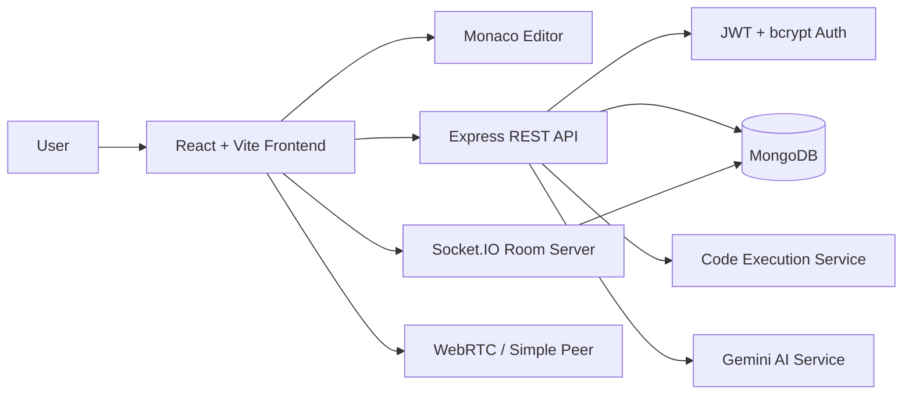

# AI-Powered Real-Time Collaborative Code Editor

## 1. Project Overview

CodeTogether is a browser-based collaborative development workspace. It combines a Monaco code editor, shared rooms, multi-file editing, live synchronization, code execution, team chat, video calling, project persistence, and an AI coding assistant in one workflow.

## 2. Problem Statement

Traditional coding environments are optimized for one developer at a time. Teams often move between an editor, chat, video calls, file sharing, and separate AI tools. That creates context switching, duplicated work, delayed feedback, and difficulty reproducing the exact code state being discussed.

CodeTogether addresses this by keeping the code, collaborators, communication, execution output, and AI assistance in a shared room.

## 3. Objectives

- Support authenticated users through registration and login.
- Create and join collaborative coding rooms.
- Edit multiple files in a shared Monaco workspace.
- Recognize common source, web, configuration, and SQL files by extension.
- Synchronize code, file operations, languages, cursors, users, and input through Socket.IO.
- Run supported programs and display output in the workspace.
- Provide team chat and optional peer-to-peer video calling.
- Provide CodePilot AI assistance using the current file context.
- Save and reload project files and per-file language metadata.
- Provide an accessible responsive light/dark interface.

## 4. Technology Stack

| Layer | Technology | Responsibility |
| --- | --- | --- |
| Frontend | React + Vite | Application UI, routing, editor workflow |
| Editor | Monaco Editor | Code editing, language support, cursor integration |
| Backend | Node.js + Express | HTTP API, project operations, code execution |
| Realtime | Socket.IO | Rooms, code changes, chat, cursors, file events |
| Persistence | MongoDB + Mongoose | Users and saved projects |
| Authentication | JWT + bcrypt | Login sessions and password hashing |
| AI | Google Generative AI | Code explanation, debugging, and improvement |
| Video | Simple Peer + WebRTC | Browser-to-browser audio/video calls |

## 5. System Architecture

### Main flows

1. The user registers or logs in and receives a JWT.
2. The user creates a room or joins an existing room by room ID.
3. The frontend joins a Socket.IO room and loads any saved project from MongoDB.
4. Editor changes and file operations are broadcast to room members.
5. The user can run code, chat, start video, or ask CodePilot about the active file.
6. The workspace periodically saves project files, active file, and language metadata.

## 6. Demonstration Script

### A. Authentication

1. Open the application.
2. Register a new account.
3. Sign in and confirm the Workspace link and Sign out control.

### B. Room collaboration

1. Click **Start a new room**.
2. Copy the room ID.
3. Open a second browser window or private window.
4. Sign in as another user and join the room.
5. Type in the same file and show the change in both windows.
6. Show the online user list and remote cursor behavior.

### C. Multi-file editing

1. Create a new file such as `utils.py`.
2. Confirm the language and starter comment.
3. Rename the file.
4. Switch between files.
5. Delete the file and confirm the remaining file stays available.

### D. Execution and communication

1. Select JavaScript or Python.
2. Add a short program.
3. Provide input when needed.
4. Click **Run Code** and show the output panel.
5. Send a message in Team Chat.
6. Start Join Video and demonstrate microphone/camera controls.

### E. AI assistance

1. Open CodePilot AI.
2. Ask it to explain or debug the active file.
3. Show the response.
4. Insert generated code only when appropriate.

### F. Persistence

1. Edit a file.
2. Refresh the page or leave and rejoin the room.
3. Confirm saved files and language metadata are restored.

## 7. Current Implementation Status

| Capability | Status | Evidence |
| --- | --- | --- |
| Registration and login | Implemented | `/api/auth/register`, `/api/auth/login` |
| JWT token storage | Implemented | Client stores token after login |
| Room creation and joining | Implemented | React room navigation and Socket.IO `join-room` |
| Multi-file editing | Implemented | Create, rename, delete, switch events |
| Real-time code sync | Implemented | `code-change` and `receive-code` |
| Online users | Implemented | `users-update` |
| Remote cursor signal | Implemented | `cursor-change` and `cursor-update` |
| Language selection | Implemented | Per-file language state and broadcast |
| VS Code-style file types | Improved | JavaScript, TypeScript, Python, Java, C++, Go, PHP, HTML, CSS, JSON, SQL, and YAML editor modes |
| Code execution | Prototype implemented | `/run` supports configured languages |
| Project save/load | Implemented | `/save-project` and `/load-project/:roomId` |
| Team chat | Implemented | Socket.IO message events |
| Video calling | Prototype implemented | Simple Peer signaling and media controls |
| AI assistant | Implemented with external dependency | `/ai` and CodePilot panel |
| Responsive landing page | Implemented | Responsive light/dark public UI |
| Production security hardening | In progress | See risks below |

## 8. Important Risks and Recommended Improvements

## 8A. Requirement Mismatch Audit

| Intended project idea | Current implementation | Match level | What is missing |
| --- | --- | --- | --- |
| Secure multi-user workspace | JWT login plus protected project, AI, execution, and Socket.IO entry points | Improved prototype | Enforce membership permissions for every room event |
| Private collaborative rooms | Projects now record owner and member metadata; authenticated room access is required | Partial | Invitations and strict room membership authorization |
| Real-time collaborative editing | Socket.IO broadcasts whole-file changes | Prototype | Conflict handling, revision IDs, reconnect recovery, and durable event ordering |
| Multi-file project editing | Create, rename, delete, switch, save, and load exist | Good prototype | Server-side filename validation and atomic file operations |
| Reliable persistence | One authenticated project API now stores files, metadata, ownership, and timestamps | Improved prototype | Save conflict protection and visible save status |
| Code execution | Local child processes execute submitted code | Prototype/risk | Isolated sandbox, quotas, resource limits, and cross-platform runners |
| AI coding assistant | Gemini endpoint receives prompt, code, and chat history | Prototype | Authenticated quota control, privacy policy, bounded context, and usage limits |
| Video collaboration | WebRTC signaling and media controls exist | Prototype | Disconnect cleanup, TURN fallback, permission states, and call membership authorization |
| Demonstrable product | Landing page and editor workflows exist | Good | Automated demo verification and a stable seed/demo room |
| Production-ready application | No API schema validation, rate limiting, or test suite is present | Not yet | Security, tests, observability, and deployment configuration |

### Current technical inconsistencies

- Project persistence is now consolidated under `routes/projectRoutes.js` and the client uses `/project/save` and `/project/load/:roomId`.
- The project schema still accepts legacy language metadata through the file language map; a separate project-level language field is not required for the multi-file model.
- `ProtectedRoute` only checks whether a token exists in `localStorage`; it does not verify expiry or validate the token with the server.
- Socket.IO now uses a JWT handshake, but room-level permission checks still need to be enforced for every event.
- The server removes duplicate usernames from `roomUsers`, but the older socket can remain connected and later affect room state.
- Video users are removed on explicit leave and socket disconnect; TURN support and permission states remain future work.
- Code execution still uses shell commands and writes temporary files into the application directory. Input/code size limits and compiled artifact cleanup are now present, but isolation is still required.
- Java, Go, and PHP execution paths contain machine-specific assumptions, so the feature is not portable to another development machine or deployment host.
- The editor is a single large component, which makes collaboration, video, AI, persistence, and editor behavior difficult to test independently.
- There is no explicit loading, save-success, reconnect, or offline state in the editor, so users cannot reliably tell whether their latest work is persisted.
- Whole-file Socket.IO updates can overwrite a collaborator's newer change because there is no revision or conflict protocol.

### Recommended delivery order

1. Add shared JWT middleware for HTTP and Socket.IO, then enforce room membership.
2. Consolidate project APIs and add request validation for room IDs, filenames, languages, messages, and project payloads.
3. Replace host execution with an isolated runner and add timeout/resource tests.
4. Add revision-aware collaboration and reconnect synchronization.
5. Split the editor into testable feature components and add end-to-end tests for the demonstration script.
6. Add deployment configuration, environment-based CORS, structured logging, and health checks.

### High priority

- **Sandbox code execution.** `/run` currently writes files and executes commands on the server host. It should move to an isolated worker/container with CPU, memory, timeout, filesystem, and network limits.
- **Authenticate project APIs.** Save/load currently accepts a room ID without validating the JWT or room membership.
- **Authenticate Socket.IO connections.** Validate the JWT during the Socket.IO handshake and authorize room events.
- **Validate request payloads.** Add schema validation for registration, login, project data, chat messages, code, language, and room IDs.
- **Remove secrets from logs and responses.** Keep AI/provider and database errors server-side and return safe client messages.

### Medium priority

- Split `EditorPage.jsx` into FileExplorer, EditorSurface, WorkspaceToolbar, TeamChat, OutputPanel, AIPanel, and VideoPanel components.
- Replace broad CORS configuration with an environment-based allowlist.
- Add rate limiting for authentication, AI requests, and code execution.
- Add server-side message length and filename validation.
- Add a proper room/project ownership and membership model.
- Add automated tests for auth, project persistence, room events, and execution timeouts.

## 9. Future Scope

- Safer cloud execution using isolated containers or a job queue.
- More language runtimes and syntax support.
- Database-aware workspaces with SQL files, connection profiles, schema browsing, and safe query execution.
- AI-powered code generation, refactoring, test generation, and debugging.
- Version history, snapshots, undo, and conflict-aware collaborative editing.
- Team projects, invitations, permissions, and project ownership.
- Cloud deployment with managed MongoDB and object storage.
- Notifications, presence history, and activity timeline.
- Automated unit, integration, and end-to-end test coverage.

## 10. Honest Project Positioning

The current project is a functional collaborative editor prototype with a strong demonstration surface. Its collaboration, editor, persistence, AI, chat, and video workflows are suitable for a project review. Before public deployment, code execution isolation, API authorization, Socket.IO authentication, validation, and automated tests should be treated as required engineering work rather than optional polish.
